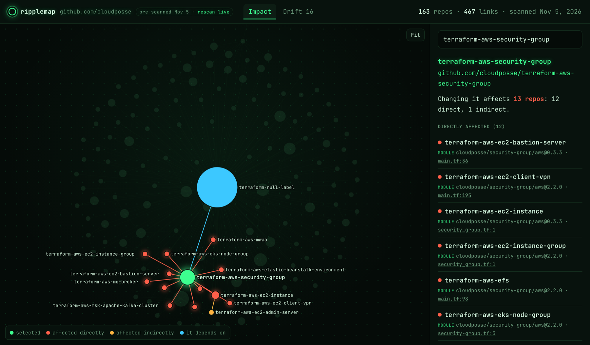

# ripplemap

**See which repos break when you change one.**

[**Try it on any public org, in your browser**](https://zintrivious.github.io/ripplemap/) · [Live demo](https://zintrivious.github.io/ripplemap/map/?org=linuxserver#repo=linuxserver%2Fdocker-baseimage-alpine) · [npm](https://www.npmjs.com/package/ripplemap)

You're about to change a shared base image, Terraform module, CI workflow or library. Which repos use it? Which are still on an old version? Usually the answer lives in someone's head or a stale wiki page.

ripplemap reads the files your repos already have and answers in seconds: Dockerfiles, Terraform, GitHub Actions, Kubernetes, Helm, Compose, npm, Go and Python. There's no catalog to write, no server to run, and nothing leaves your machine.

[](https://zintrivious.github.io/ripplemap/map/?org=cloudposse#repo=cloudposse%2Fterraform-aws-security-group)

**What you can do with it**

- **Before a breaking change:** see exactly which repos to update and who to tell.
- **On every pull request:** a [GitHub Action](#on-every-pull-request) comments with the repos the change may affect.
- **Version drift:** find repos still on an old base image, module or library.
- **Unpinned references:** find repos on `latest` or `@main` that change underneath you.

## Quick start

Two commands. Needs Node.js 22 or newer, and nothing to clone:

```bash
npx ripplemap scan --org your-org
npx ripplemap report --open
```

If you're logged in with the [GitHub CLI](https://cli.github.com) (`gh auth login`), that's all the setup there is, and private repos work too. Otherwise set `GITHUB_TOKEN` to any token. Without one, GitHub only allows enough requests for about 50 repos an hour.

Then, in the terminal:

```bash
npx ripplemap impact <repo>    # everything a change to <repo> would affect
npx ripplemap drift            # shared things used at different versions
npx ripplemap unpinned         # references that pin no version
```

```
$ ripplemap impact base-images

base-images
├─ api  image ghcr.io/acme/base:1.4  Dockerfile:1
│  └─ frontend  image ghcr.io/acme/api:latest  docker-compose.yml:3
└─ web  image ghcr.io/acme/base:1.2  Dockerfile:1

3 repos affected: 2 direct, 1 indirect.
```

`frontend` never mentions `base-images`. It runs the `api` image, which is built on top of it. ripplemap follows that chain.

Scans are fast and cached. Cloud Posse's 163 Terraform repos took 25 seconds the first time; repeat scans take about 5 seconds, because only repos with new pushes are fetched again. Already have the repos cloned? Run `npx ripplemap scan ~/code/your-org` instead.

**On Azure DevOps?** Scan the organization directly, with a [personal access token](https://learn.microsoft.com/azure/devops/organizations/accounts/use-personal-access-tokens-to-authenticate) that has Code (read) scope:

```bash
AZURE_DEVOPS_TOKEN=<your PAT> npx ripplemap scan --azure-org your-org
npx ripplemap report --open
```

Public projects work without a token: `npx ripplemap scan --azure-org your-org --project YourProject`. Module sources and remotes are matched however they're written: `https://dev.azure.com/...`, `git@ssh.dev.azure.com:v3/...` or `*.visualstudio.com`.

Or install it globally with `npm install -g ripplemap`.

## On every pull request

The GitHub Action comments on a pull request with the repos the change may affect. Add this to the repos other repos depend on, such as shared modules, base images, reusable workflows and libraries:

```yaml
# .github/workflows/ripplemap.yml
name: ripplemap
on: pull_request_target
permissions:
  contents: read
  pull-requests: write
jobs:
  impact:
    runs-on: ubuntu-latest
    steps:
      - uses: Zintrivious/ripplemap@v0
        # with:
        #   token: ${{ secrets.RIPPLEMAP_TOKEN }}   # for private repos, see below
```

Here's what it posted when told that a pull request changes Cloud Posse's `terraform-aws-security-group` (shortened):

> ### ripplemap: this pull request may affect 13 repos
>
> 12 directly and 1 through other repos.
>
> #### `cloudposse/security-group/aws` · Terraform module
>
> Changed here: `main.tf`, `variables.tf`
>
> | Repo | Uses | Where |
> |---|---|---|
> | terraform-aws-ec2-bastion-server | `0.3.3` | main.tf:36 |
> | terraform-aws-ec2-client-vpn | `2.2.0` | main.tf:195 |
> | terraform-aws-ec2-instance | `0.3.3` | security_group.tf:1 |
> | … | | |

How it decides what a change touches:

- **Only the part that changed counts.** An edit to `.github/workflows/build.yml` affects callers of that workflow, not every user of the repo. An edit under `vpc/` affects users of the `vpc` module, and an edit in a package's folder affects that package's users. Container images count any edit, since their build context isn't known.
- **Docs, tests and examples are ignored**, so a README edit doesn't alarm anyone.
- **Repos that pin nothing are called out.** A repo on `@main` or `latest` gets the change the moment it merges. The rest only feel it when they upgrade.
- **The chain follows one kind of dependency.** A base image change reaches images built on images built on it, but a Terraform module change doesn't flag the users of a repo's container image.
- **It's a list to check, not a list of breakages.** ripplemap reads references; it doesn't build or test anything.

It keeps one comment up to date as the pull request changes, writes the same report to the job summary, and doesn't comment at all when nothing is affected.

**Permissions and safety.** The Action reads the pull request's file list through the API and never checks out or runs the pull request's code. That's why `pull_request_target` is safe here, and it's what lets it comment on pull requests from forks. Don't add a checkout of the pull request's code to the same job. The default job token can read public repos. To scan private repos, pass a token with read access to every repo in the org, either a fine-grained personal access token with Contents: read or a GitHub App token.

| Input | Default | |
|---|---|---|
| `token` | job token | Reads the org's repos. Needs read access to all of them for private orgs. |
| `org` | the repo's owner | Org or user to scan |
| `match` | | Only repos whose names match these globs, e.g. `terraform-* platform-*` |
| `exclude` | | Folders to skip in every repo, e.g. `examples test` |
| `comment` | `affected` | `affected`: comment when something is affected; `always`: also when nothing is; `never`: job summary only |
| `strict` | `false` | Fail the step when the scan was incomplete |
| `comment-token` | job token | Reads the pull request's files and posts the comment |

Outputs: `affected` (repos the change may affect), `direct`, and `complete` (`"true"` when every file could be read). The Action sets up Node 24 for the job it runs in, so give it a job of its own as above.

To check a change before opening a pull request, run the same analysis locally:

```bash
git diff --name-only main | npx ripplemap affected <repo> --files -
```

## Commands

### `ripplemap scan --org <name>` / `ripplemap scan <dir>`

Scans a GitHub org or user through the API, or a folder of cloned repos (or a single repo), and writes `ripplemap.json`.

| Option | |
|---|---|
| `--org <name>` | GitHub org or user to scan without cloning |
| `--azure-org <org>` | Azure DevOps organization to scan without cloning. Uses `AZURE_DEVOPS_TOKEN` (or `AZURE_DEVOPS_EXT_PAT`, or `SYSTEM_ACCESSTOKEN` inside a pipeline). |
| `--project <name>` | With `--azure-org`: only these projects (repeatable). Needed for public projects scanned without a token. |
| `--match <glob>` | With `--org`: only repos whose name matches, e.g. `terraform-*`. Repeatable. |
| `--include-forks`, `--include-archived` | With `--org`: forks and archived repos are skipped by default |
| `--no-cache` | With `--org`: don't read or write the download cache (`~/.cache/ripplemap`) |
| `--owner <org>` | With a folder: org name for repos without a git remote |
| `--exclude <dir>` | Skip a folder name (`examples`) or repo-relative path (`test/fixtures`). Repeatable. |
| `--out <file>` | Where to write the graph (default `ripplemap.json`) |
| `--verbose` | Show files that could not be read or parsed |
| `--strict` | Exit with code 1 if anything could not be read (every command takes this; see [Incomplete scans](#incomplete-scans)) |

### `ripplemap impact <repo>`

Every repo that depends on `<repo>`, directly or through other repos, with the file and line of each reference. `--json` for scripting.

### `ripplemap affected <repo> --files <list>`

What a specific change to `<repo>` may affect, as described in [On every pull request](#on-every-pull-request). `--files` takes a file with one path per line, or `-` for stdin. Add `--markdown` for the pull request comment or `--json` for scripting.

### `ripplemap drift`

Shared things used at more than one version. Here it is on all 163 of [Cloud Posse](https://github.com/cloudposse)'s Terraform module repos, with examples and tests excluded. They're a well-run org that uses Renovate, and 16 of their own modules are still used at mismatched versions:

```
$ ripplemap scan --org cloudposse --match 'terraform-*' --exclude examples --exclude test
$ ripplemap drift --internal

cloudposse/security-group/aws  module · built in terraform-aws-security-group · 3 versions across 12 repos
  2.2.0  terraform-aws-ec2-client-vpn, terraform-aws-ec2-instance-group, terraform-aws-efs +5 more
  1.0.1  terraform-aws-elastic-beanstalk-environment, terraform-aws-mwaa
  0.3.3  terraform-aws-ec2-bastion-server, terraform-aws-ec2-instance

cloudposse/utils/aws  module · built in terraform-aws-utils · 2 versions across 3 repos
  1.4.0     terraform-aws-config, terraform-aws-dynamic-subnets
  unpinned  terraform-aws-github-action-token-rotator
```

| Option | |
|---|---|
| `--internal` | Only things built in your scanned repos (hides `actions/checkout` and similar) |
| `--kind <kind>` | `image`, `terraform-module`, `workflow`, `action`, `npm`, `helm-chart`, `go` or `python`. Repeatable. |
| `--fail` | Exit with code 1 when drift is found, so you can run it in CI |
| `--json` | Full output for scripting |

### `ripplemap unpinned`

References that pin nothing: `FROM ghcr.io/acme/base` (latest), `uses: acme/ci/.github/workflows/build.yml@main`, Terraform modules without a `ref` or `version`. Every release of the repo that builds them reaches these consumers without anyone opening a pull request.

```
$ ripplemap unpinned

cloudposse/utils/aws  module · built in terraform-aws-utils
  unpinned  terraform-aws-github-action-token-rotator  main.tf:11

1 unpinned reference to things built in your repos. Each one picks up new releases without a pull request.
```

| Option | |
|---|---|
| `--all` | Include third-party references too (e.g. `actions/checkout@main`) |
| `--fail` | Exit with code 1 when any are found |
| `--json` | Full output for scripting |

### `ripplemap report`

Writes `ripplemap.html`: one self-contained page with an interactive graph, the impact of any repo, and the drift table. It has no external scripts or fonts, so it works offline and can be attached to a ticket or posted in Slack. File references link straight to the line on GitHub. Add `#repo=<owner/name>` to the URL to open the page with that repo selected.

| Option | |
|---|---|
| `--graph <file>` | Graph to read (default `ripplemap.json`) |
| `--out <file>` | Where to write the page (default `ripplemap.html`) |
| `--open` | Open it in your browser |

## What it understands

| File | Uses | Produces |
|---|---|---|
| `Dockerfile`, `*.dockerfile`, `Containerfile` | `FROM` and `COPY --from` images (resolves `ARG` defaults, skips build stages) | |
| `*.tf` | `module` sources: git (`git::`, `github.com/...`), and registry (`org/name/provider`) | the module, by repo name |
| `.github/workflows/*.yml`, `action.yml` | actions, reusable workflows, `docker://` images, job `container` and `services` images | images pushed with `docker/build-push-action`, `docker/metadata-action`, or `docker push` |
| `package.json` | `dependencies`, `devDependencies`, `peerDependencies`, `optionalDependencies` | the package `name` |
| `compose.yml`, `docker-compose*.yml` | service `image`s | |
| Kubernetes manifests (`*.yaml` with `apiVersion` and `kind`) | `containers`, `initContainers` and `ephemeralContainers` images in any workload, including CRDs, across multi-document files | |
| Helm `Chart.yaml`, `values*.yaml` | chart `dependencies` (not `file://`), images in values as `image: repo:tag` or `{ registry, repository, tag }` | the chart, by `name` |
| `go.mod` | direct `require`s (`// indirect` ones are found by following the chain) | the `module` path |
| Azure Pipelines YAML | `template: path@alias` from other repos declared under `resources.repositories` (Azure Repos and GitHub), and `resources.containers` images | |
| `pyproject.toml`, `requirements*.txt` | PEP 621 `dependencies`, optional dependencies and `[dependency-groups]`, Poetry dependency tables, requirement lines and `git+https://` URLs | the `[project]` or Poetry `name` |

### How references are linked to repos

Every link carries a confidence level so you know how much to trust it:

- **exact**: the reference names the repo (`acme/ci/.github/workflows/build.yml@v2`, `git::https://github.com/acme/modules.git//vpc`). Terraform registry modules count too, since registries only publish repos named `terraform-<provider>-<name>`.
- **declared**: another repo declares it produces the thing (a `package.json` `name`, an image push in CI).
- **convention**: guessed from naming. `ghcr.io/acme/api` is probably built by `acme/api`, `docker-api` or `api-docker`, or failing those by the one repo whose name matches without punctuation (`argocd` → `argo-cd`). These are marked `(guessed from name)` in the output.

### Incomplete scans

A dependency map that silently misses links makes a change look safer than it is. So every file or repo ripplemap can't read or parse is recorded in the graph, and `impact`, `drift`, `unpinned` and `report` say so when a graph is incomplete. Add `--strict` to any command to exit with code 1 instead, so CI never acts on a partial graph. Very large repos whose file list GitHub truncates are fetched folder by folder rather than scanned in part.

## Tested on real orgs

Every parser has been run against public GitHub orgs, and the problems found were fixed (see the commit history):

| Org | Repos | Cross-repo links | What it exercised |
|---|---|---|---|
| [linuxserver](https://github.com/linuxserver) | 288 | 2,053 | Docker base images: changing `docker-baseimage-alpine` affects 204 repos, 83 directly and 121 through other base images |
| [sindresorhus](https://github.com/sindresorhus) | 955 | 1,542 | npm: `execa` is used by 162 repos across 9 major versions |
| [cloudposse](https://github.com/cloudposse) (`terraform-*`) | 163 | 467 | Terraform modules and shared workflows |
| [hashicorp](https://github.com/hashicorp) (`go-*`) | 42 | 69 | Go modules |
| [argoproj](https://github.com/argoproj) | 27 | 63 | Kubernetes manifests, Helm charts, multi-MB install bundles |
| [jupyter](https://github.com/jupyter) | 60 | 52 | Python packages (`jupyter_core` and `jupyter-core` are one package) |

Spot-checked links point at the exact dependency line in the real files.

### Known limits

- It reads files, not traffic. Service A calling service B over HTTP is invisible unless a config file names it. Your APM tool covers that side.
- Images whose names are built from build-script variables can't be resolved statically, so they aren't linked to the repo that builds them. Argo's `workflow-controller` image is one example.
- Folders named `node_modules`, `vendor`, `fixture(s)`, `__fixtures__`, `testdata` and `__snapshots__` are skipped. Their manifests are installed dependencies or deliberately fake test data.
- When scanning a folder, repos are found one level deep: `repos/<repo>`. Nested layouts aren't supported yet.
- Scanning without cloning works for github.com (`--org`) and Azure DevOps Services (`--azure-org`). GitHub Enterprise Server, Azure DevOps Server, GitLab and Bitbucket work by scanning a folder of clones.
- Pull request comments are GitHub-only for now.

## Roadmap

- Pull request comments on Azure DevOps
- Scanning GitHub Enterprise Server, GitLab and Bitbucket without cloning
- The Action on GitLab merge requests

Bug reports with real-world files ripplemap misreads are the most useful contribution there is. Check the [issues](https://github.com/Zintrivious/ripplemap/issues).

## Contributing

Adding a parser is the easiest way in. A parser is one file with a `matches(file)` and a `parse(...)` function, and you don't need to touch the rest of the code. [CONTRIBUTING.md](CONTRIBUTING.md) walks through it.

## License

MIT
